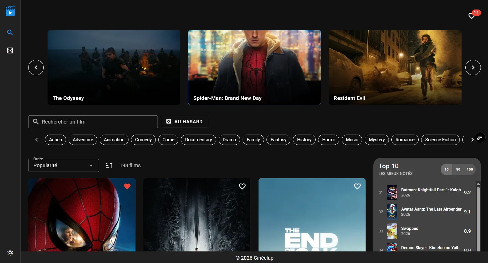
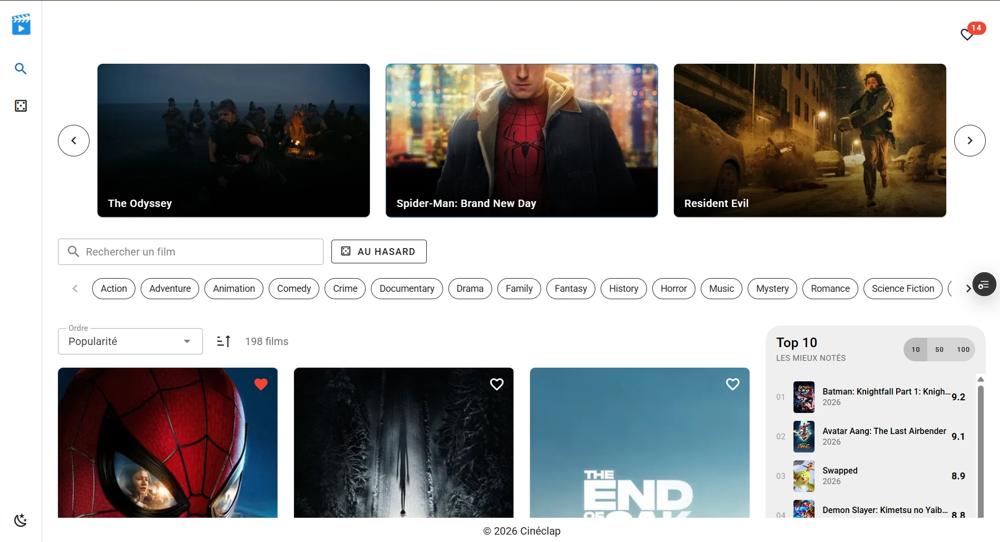
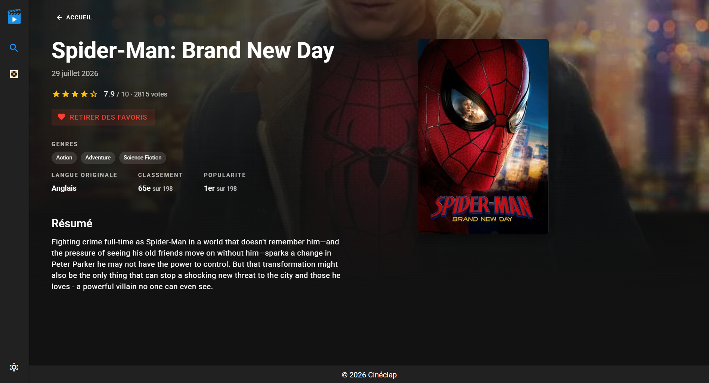
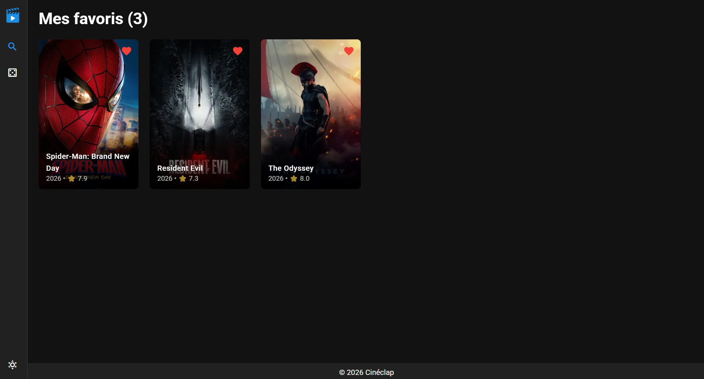
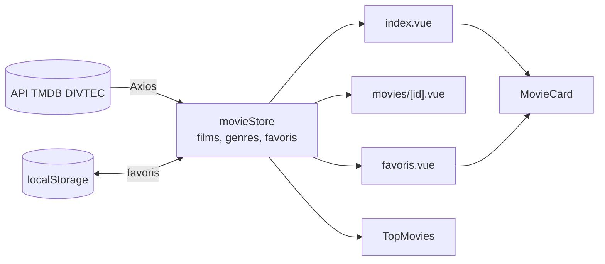

# 🎬 Cinéclap

## 1. 🎨 Présentation du projet

### Concept
- **API choisie** : API TMDB (The Movie Database) : Je suis un grand fan de cinéma, je regarde un film presque chaque jour. Le sujet m'a donc tout de suite parlé.
- **Public cible** : Mon public cible, ce sont les personnes qui, comme moi, aiment regarder des films mais qui ont du mal à se décider.
- **Objectifs** : Le but de l’application est de découvrir les films récents, de comparer les notes et de pouvoir choisir un film au hasard, sans le stress du choix.

### Fonctionnalités principales
- **Liste des films** : un carrousel avec les 5 films les plus populaires et un catalogue de 198 films avec pagination (24 films par page).
- **Recherche / Tri / Filtres** : recherche par titre, filtre par genre et tri par popularité, note, date de sortie ou titre (ordre croissant ou décroissant).
- **Vue détail** : une page pour chaque film avec l'affiche, l'image de fond, la note, les genres, la langue originale, le classement et le résumé.
- **Fonctionnalité interactive** : les favoris, avec un bouton ♥ sur chaque carte et sur la page du film pour ajouter ou retirer un film, un message de confirmation et une page « Mes favoris ». Un bouton permet aussi de passer du mode clair au mode sombre.
- **Film au hasard** : un bouton qui ouvre la page d'un film choisi au hasard.
- **Top des films** : top 10 / 50 / 100 des films les mieux notés.
- **Page 404** : une page s'affiche si l'adresse n'existe pas.
- **Persistance locale** : les favoris sont enregistrés dans le localStorage et restent après un rechargement de la page.

### Aperçu visuel
**Page d'accueil (mode sombre)**


**Page d'accueil (mode clair)**


**Page d'un film**


**Mes favoris**


---

## 2. 📚 Parcours d'apprentissage

### Ressources utilisées
#### Documentation & tutos
- [Vue 3 Docs](https://vuejs.org/guide/introduction.html)
- [Vuetify Docs](https://vuetifyjs.com/en/components/all/)
- [Pinia Docs](https://pinia.vuejs.org/)
- [Vue Router Docs](https://router.vuejs.org/)
- [Axios Docs](https://axios-http.com/fr/docs/intro)
- [DEV {JS} – Bases de Vue.js](https://devjs.ch/vue/bases.html) : ref, computed, watch, onMounted, v-model
- [DEV {JS} – Composants](https://devjs.ch/vue/composants.html) : props, emits, slots
- [DEV {JS} – Exercice Pokédex Vuetify](https://devjs.ch/exercices/pokedex-vuetify/) : base pour le store, Axios, la recherche et les favoris
- [API TMDB de l'école (DIVTEC)](https://apis.divtec.me/api/tmdb-api/docs) : documentation de l'API (Swagger)

#### Progression
- **Semaine 1 (22.09)** : création du projet. Après la validation de l'API, j'ai défini les pages du site et préparé la maquette principale avec draw.io
- **Semaine 2 (12.10 – 18.10)** : page d'accueil avec les films de l'API, Top 10 / 50 / 100, pagination du catalogue et page de détail d'un film (image de fond, langue, classement, étoiles).
- **Semaine 3 (19.10 – 25.10)** : mise en place du store Pinia et d'Axios avec un fichier `.env`, code repris pour n'utiliser que ce qui a été vu en cours, bouton « film au hasard » et mise en ligne sur Vercel.
- **Semaine 4 (26.10 – 01.11)** : remplacement de la plupart du CSS par des composants Vuetify (barre latérale, Top 10, cartes, grille), ajout du logo, du nom « Cinéclap », d'un footer avec un slot et d'une page 404.
- **Semaine 5 (02.11 – 08.11)** : après les retours de l'enseignant, recherche par titre, filtre par genre et tri sur l'accueil ; favoris avec le localStorage et page « Mes favoris » ; mode clair / sombre ; configuration de Vercel ; nettoyage du code.
- **Semaine 6 (09.11 – 10.11)** : rédaction du README, captures d'écran et préparation de la défense orale.

---

## 3. 🛠️ Outils et méthodologie

### Environnement de développement
- **IDE** : WebStorm
- **Versioning** : GitHub
- **Hébergement** : Vercel
- **Dépendances principales** : Vue 3.5, Vuetify 3.10, Pinia 3, Vue Router 4, Axios 1.12, Vite 6
- **Gestion API Keys** : l'API de l'école ne demande pas de clé. Le fichier `.env` contient seulement les adresses de l'API et des images (`VITE_API_URL`, `VITE_IMAGES_URL`). Le fichier `.env.example` sert de modèle et le `.env` n'est pas envoyé sur GitHub (`.gitignore`).

### Installation & Run
- **Prérequis** : Node.js (version 18 ou plus) et npm
-  **Cloner le repo** :
  ```bash
  git clone https://github.com/ozan-kulug/294-projet-TMDB-siyakul.git
  cd 294-projet-TMDB-siyakul
  ```
-  **Installer** :
  ```bash
  npm install
  ```
- **Variables d'environnement** : copier `.env.example` → `.env`. Aucune clé n'est nécessaire, les adresses de l'API sont déjà remplies.
  ```bash
  cp .env.example .env
  ```
(sous Windows : `copy .env.example .env`)

- **Lancer** :
  ```bash
  npm run dev
  ```
  Le site s'ouvre sur http://localhost:3000
- Variables d’environnement : copier `.env.example` → `.env` et compléter les clés nécessaires

### Méthodologie
- **Découpage en composants réutilisables** : `MovieCard` est utilisé sur l'accueil et sur la page des favoris ; `TopMovies`, `AppSidebar` et `AppFooter` sont des composants séparés.
- **Props & slots** : les données passent du parent à l'enfant avec des props (`MovieCard` reçoit le film avec `defineProps`) ; le footer utilise un slot.
- **Store global avec Pinia** : les films, les genres et les favoris sont chargés une seule fois dans le store et partagés entre toutes les pages. Un deuxième store (`app`) gère l'interface.
- **Commits réguliers et explicites**, en français.
- **Tests manuels** dans le navigateur après chaque changement : affichage, recherche, favoris après un rechargement, erreurs de l'API, mobile.
- **Code basé sur le cours** : j'ai utilisé seulement ce qui a été vu en cours (devjs.ch) et j'ai suivi l'exercice Pokédex Vuetify pour le store, la recherche et les favoris.

### Choix techniques
- API sélectionnée : [API TMDB de l'école](https://apis.divtec.me/api/tmdb-api/docs)
- Justification du choix : le cinéma est ma passion, l'API contient des films récents avec affiches, images de fond, notes, popularité, genres et résumés, ce qui suffit pour une liste, une page détail, une recherche, des filtres et des tris. Aucune clé API n'est nécessaire pour lire les données.
- **Endpoints utilisés** :
    - `GET /movies?limit=100&page=N` : liste des films (toutes les pages sont chargées au démarrage)
    - `GET /genres?limit=100` : liste des genres
    - Images : `https://apis.divtec.me` + `posterPath` / `backdropPath`
- **Limites / quotas connus** :
    - seulement 198 films et 19 genres ;
    - à partir du film n°105, il n'y a plus d'affiche : l'image de fond est utilisée à la place ;
    - pas d'informations sur les acteurs ;

### Architecture (Descriptif + schéma simple + data-flow)
- `App.vue` : composant racine, lance le chargement des données (`movieStore.init()`) au démarrage.
- `layouts/default.vue` : mise en page commune à toutes les pages (barre latérale, contenu, footer).
- `pages/` : une page = une route (routing automatique)
    - `index.vue` → `/` : carrousel, recherche, filtres, tri, catalogue et Top
    - `movies/[id].vue` → `/movies/:id` : page détail d'un film
    - `favoris.vue` → `/favoris` : films favoris
    - `[...path].vue` → toutes les autres adresses : page 404
- `components/` : `AppSidebar`, `AppFooter` (slot), `MovieCard` (props), `TopMovies`
- `stores/` : `movieStore.js` (films, genres, favoris, chargement, erreurs) et `app.js` (interface)
- `plugins/axios.js` : instance Axios avec l'adresse de l'API (lue dans `.env`)

**Schéma :**


**Data-flow résumé :**
- Au démarrage, `App.vue` appelle `movieStore.init()` → le store charge les favoris (localStorage), puis les films et les genres avec Axios.
- Les pages lisent les données du store (`storeToRefs`, getters) et les affichent.
- Recherche : l'utilisateur tape dans le champ (`v-model`) → les `computed` filtrent par genre, par titre puis trient → le catalogue se met à jour. Les données du store ne sont jamais modifiées.
- Favoris : clic sur ♥ dans `MovieCard` → `movieStore.toggleFavorite()` → le state change et est enregistré dans le localStorage → le cœur, le badge et la page des favoris se mettent à jour automatiquement.

Outils utilisés : draw.io pour la maquette du site.

---

## 4. 🧪 Tests et validation

### Tests techniques
- ✅ Appels API fonctionnels : 198 films et 19 genres chargés
- ✅ Persistance vérifiée après refresh (localStorage)
- ✅ Navigation entre les vues OK
- ✅ Recherche, filtre et tri fonctionnels
- ✅ Page 404 et « Film introuvable » pour une adresse inconnue
- ✅ Rechargement d'une page sur Vercel sans erreur 404 (`vercel.json`)

### Tests d'UX
- ✅ Navigation intuitive : barre latérale toujours visible, logo pour revenir à l'accueil, bouton retour sur la page d'un film
- ✅ Recherche / filtre / tri faciles à comprendre : résultats mis à jour pendant la frappe et nombre de films affiché
- ✅ Feedback utilisateur : chargement, message d'erreur si l'API ne répond pas, « Aucun film trouvé » si la recherche est vide
- ✅ Confirmation des actions : message « Ajouté aux favoris » / « Retiré des favoris »
- ✅ Responsive : sur mobile, le carrousel n'affiche qu'un film et le catalogue passe sur 2 colonnes

### Tests d'accessibilité
- ✅ Contraste couleurs (Vuetify par défaut, en mode clair et en mode sombre)
- ✅ Labels et placeholders corrects : champs avec un label, boutons-icônes avec un titre, images avec un texte alternatif (`alt`)
- ✅ Navigation clavier possible : tous les boutons, liens et champs sont accessibles avec la touche Tab
- ✅ Focus visible : l'élément sélectionné au clavier est mis en évidence
- ✅ Titre `<h1>` sur chaque page (sur l'accueil il est caché à l'écran mais lu par les lecteurs d'écran)
-
### Tests d'erreurs & fallback
- ✅ API down → message d'erreur (`v-alert`) au lieu d'une page vide. Pas de mock : il n'est pas obligatoire pour l'année 26-27.
- ✅ Liste vide → message clair affiché (ex. « Vous n'avez pas encore de favoris »)
- ✅ Recherche sans résultat → affichage « Aucun film trouvé »
- ✅ Film inexistant (`/movies/99999`) → message « Film introuvable »
---

## 5. 🤖 Usage d’intelligence artificielle

### IA utilisée
- **Nom** : ChatGPT / Claude / Gemini / Antigravity
- **Version** : _Opus 5.5_, _Gemini Argon 4/Pro_, _GPT 6 Luna_
- **Contexte** : Aide ponctuelle / Génération de code / Debugging / Feedbacks

### Utilisation détaillée
**Domaines d'aide :**
- Aide au code général : 75%
- Génération de snippets Vue/Vuetify : 80%
- Aide à la structuration du projet : 50%
- Debugging : 50%
- Recherche d’idées : 0%

**Compréhension et adaptation**
- **Expliquer ce que fait le code généré** : 
  - Le code a plutôt été écrit par l'IA;
  - le store Pinia charge les films une seule fois (toutes les pages en parallèle avec `Promise.all`) et les partage entre les pages ;
  - la recherche utilise des `computed` chaînés (genre → titre → tri) sans modifier les données du store ;
  - les favoris sont des ids enregistrés dans le localStorage (`JSON.stringify` / `JSON.parse`) ;
  - `@click.stop.prevent` empêche d'ouvrir la page du film quand on clique sur le cœur.
- **Dire comment il a été adapté au projet**
  - j'ai demandé de n'utiliser que ce qui a été vu en cours
  - j'ai refusé certaines propositions : une autre API pour les acteurs (je voulais rester sur l'API de l'école) et une vérification des dates de sortie
  - j'ai changé la mise en page selon les retours de l'enseignant et supprimé les boutons inutiles
  - j'ai verifier les bout de code et refuser les codes qu'on n'a pas vus.
  - j'ai écrit moi-même quelques parties du code et ajouté le fichier `vercel.json`.
    **Ce que l'IA a fait / ce que j'ai fait**

| Partie | IA                                                   | Moi                                                                                                                             |
|---|------------------------------------------------------|---------------------------------------------------------------------------------------------------------------------------------|
| `stores/movieStore.js` (films, genres, favoris) | Code écrit par l'IA                                  | Choix des fonctionnalités, tests                                                                                                |
| `pages/index.vue` (carrousel, recherche, tri, pagination) | Code écrit par l'IA                                  | Mise en page selon les retours de l'enseignant, écran de chargement (`v-skeleton-loader`), pagination sur mobile (`useDisplay`) |
| `pages/movies/[id].vue`, `favoris.vue`, page 404 | Code écrit par l'IA(`pages/movies/[id].vue`) | Choix des informations à afficher, code des pages `favoris.vue`, page 404                                                       |
| Composants (`MovieCard`, `TopMovies`, `AppSidebar`, `AppFooter`) | Code écrit par l'IA                                  | Début du bouton « film au hasard », suppression des boutons inutiles                                                            |
| Passage du CSS à Vuetify | Proposé et écrit par l'IA                            | Validation de chaque étape                                                                                                      |
| `vercel.json`, nettoyage des fichiers | –                                                    | Fait par moi                                                                                                                    |
| Maquette (draw.io), idée du site | –                                                    | Fait par moi                                                                                                                    |
| Logo | Généré par Gemini                                    | Idée et choix du logo                                                                                                           |
| README | Traduction en Français                               | Rédaction, corrections et captures d'écran                                                                                      |

### Parties codées manuellement
- Composants principaux : 20% personnel
- Store & persistance : 15% personnel
- Routing & navigation : 20% personnel
- Tests & validation : 90% personnel
### Apprentissage personnel
- **Ce que j'ai appris grâce à l'IA** :
    - comprendre mon propre code avec des explications sur mon projet : `ref` / `computed` / `watch`, le store Pinia avec `storeToRefs`, le modulo du carrousel, `@click.stop.prevent` ;
    - savoir où et comment ajouter une fonctionnalité (par exemple un nouveau filtre dans la chaîne de `computed`) ;
    - utiliser les composants Vuetify à la place du CSS.
- **Comment elle m'a aidé à progresser** :
    - j'ai pu poser des questions à chaque étape et avoir une réponse tout de suite ;
    - j'ai appris à ne pas tout accepter : vérifier ce qu'elle propose, refuser ce qui ne correspond pas au projet ou au cours ;
    - elle m'a fait gagner du temps sur le code, ce qui m'a permis de me concentrer sur les idées, le design et les tests.
---

## 6. 🎯 Bilan personnel

### Ce que j'ai appris
- **Compétences techniques acquises** : créer une application Vue 3 avec des composants et des props, gérer les données avec un store Pinia, appeler une API avec Axios et un fichier `.env`, utiliser Vue Router (routes dynamiques, page 404), construire l'interface avec Vuetify et mettre le site en ligne sur Vercel.
- **Découvertes surprenantes** :
    - Vuetify permet de faire presque toute la mise en page sans CSS : le CSS de la page film est passé de 211 à 41 lignes.
    - Le localStorage permet de garder des données sans base de données.
- **Concepts difficiles maîtrisés** :
    - la différence entre `computed` et `watch` ;
    - `@click.stop.prevent` dans une carte cliquable ;
    - le modulo (`%`) pour faire tourner le carrousel en boucle.

### Difficultés rencontrées
- **Problèmes techniques et solutions trouvées** :
    - après le 105e film, l'API ne donne plus d'affiche → j'utilise l'image de fond avec un zoom pour cacher les bandes noires ;
    - le site s'affichait vide après une modification du bouton « film au hasard » → il manquait le code JavaScript dans le composant.
- **Moments de blocage et dépassement** :
    - je voulais afficher les acteurs des films, mais l'API n'a pas ces données. J'ai décidé de ne pas utiliser une autre API et de rester sur celle de l'école ;
    - la recherche s'ouvrait dans une fenêtre séparée. Après les retours de l'enseignant, je l'ai remplacée par une vraie recherche sur l'accueil.
- **Aide reçue et sources** : retours de l'enseignant pendant les points de suivi, cours devjs.ch (Bases de Vue.js, exercice Pokédex Vuetify), documentation Vue / Vuetify / Pinia et IA (voir partie 5).

### Réussites et fiertés
- **Aspects du projet dont je suis fier** :
    - le design du site : le carrousel en haut de l'accueil et la page du film avec son image de fond ;
    - le bouton « film au hasard », qui répond à l'objectif du site : aider ceux qui n'arrivent pas à choisir.
- **Progrès constatés depuis le début** :
    - au début, je ne savais pas comment organiser une application Vue ; maintenant je comprends le rôle du store, des pages, des composants et du routeur ;
    - au début, j'écrivais beaucoup de CSS ; maintenant j'utilise les composants Vuetify.
- **Envies de développement futur** :
    - permettre aux utilisateurs du site de noter les films et afficher la moyenne de leurs notes ;
    - si possible, relier Cinéclap à une API plus grande, avec plus de films.


### Améliorations possibles
- **Ce que j'ajouterais avec plus de temps** :
    - un design plus adapté aux écrans de téléphone ;
    - afficher les genres sur les cartes des films ;
    - refaire le logo pour qu'il change quand on passe la souris dessus.
- **Fonctionnalités bonus envisagées** :
    - un filtre par note (ex. seulement les films notés 7 ou plus) ;
    - un filtre par langue originale.
- **Compétences à approfondir** :
    - rendre `index.vue` plus simple en le découpant en plusieurs composants ;
    - écrire tout le code dans une seule langue.

---

## 7. 📚 Références & Sources
- **Documentation de l'API** : [API TMDB de l'école (DIVTEC)](https://apis.divtec.me/api/tmdb-api/docs) – données issues de [The Movie Database (TMDB)](https://www.themoviedb.org/), usage pédagogique
- **Tutos clés utilisés** :
    - [DEV {JS} – Bases de Vue.js](https://devjs.ch/vue/bases.html)
    - [DEV {JS} – Exercice Pokédex Vuetify](https://devjs.ch/exercices/pokedex-vuetify/)
    - [Documentation Vuetify – composants](https://vuetifyjs.com/en/components/all/)
- **Usage de l'IA** : voir la partie 5
- **Autres ressources utiles** :
    - [Material Design Icons](https://pictogrammers.com/library/mdi/) : icônes du site (`mdi-heart`, `mdi-magnify`…)
    - [MDN – localStorage](https://developer.mozilla.org/fr/docs/Web/API/Window/localStorage) : sauvegarde des favoris
    - [Vercel – Rewrites](https://vercel.com/docs/project-configuration#rewrites) : configuration de `vercel.json`
    - [draw.io](https://www.drawio.com/) : maquette du site
