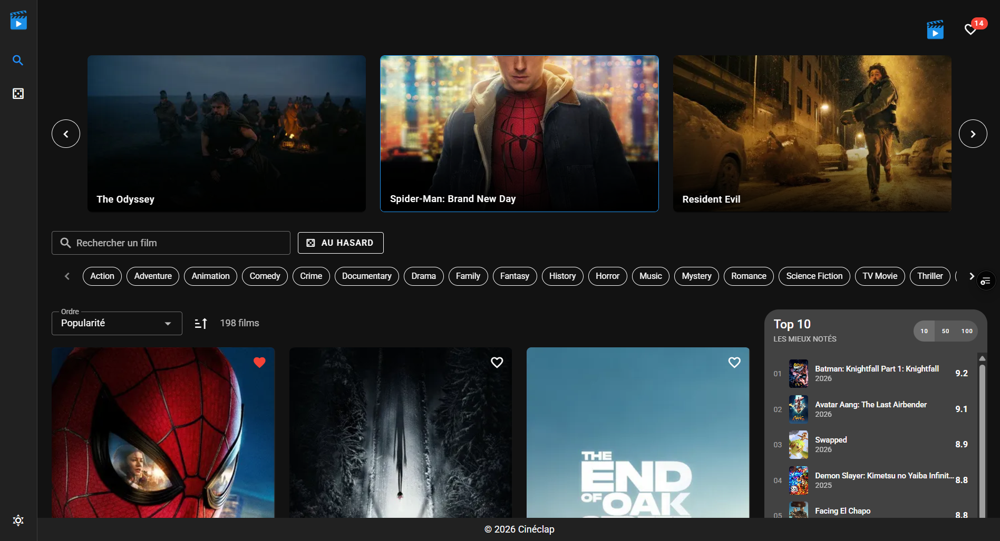
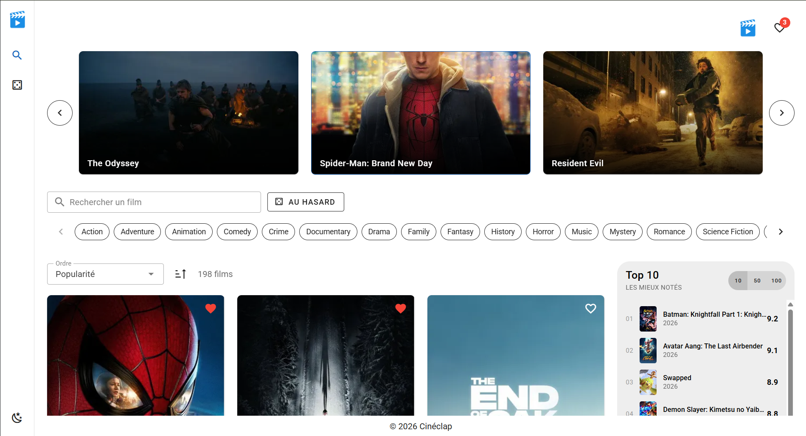

# 🎬 Cinéclap

## 1. 🎨 Présentation du projet

### Concept
- **API choisie** : API TMDB (The Movie Database) : Je suis un grand fan de cinéma, je regarde un film presque chaque jour. Le sujet m'a donc tout de suite parlé.
- **Public cible** : Mon public cible, ce sont les personnes qui, comme moi, aiment regarder des films mais qui ont du mal à se décider.  
- **Objectifs** : Le but de l’application est de découvrir les films récents, de comparer les notes et de pouvoir choisir un film au hasard, sans le stress du choix.  

### Fonctionnalités principales
- **Liste des films** : un carrousel avec les 5 films les plus populaires et un catalogue de 198 films avec pagination (24 films par page).
- **Recherche / Tri / Filtres** : recherche par titre, filtre par genre et tri par popularité, note, date de sortie ou titre (ordre croissant ou décroissant).
- **Vue détail** : une page pour chaque film avec l'affiche, l'image de fond, la note, les genres, la langue originale, le classement et le résumé.
- **Fonctionnalité interactive** : les favoris, avec un bouton ♥ sur chaque carte et sur la page du film pour ajouter ou retirer un film, un message de confirmation et une page « Mes favoris ». Un bouton permet aussi de passer du mode clair au mode sombre.
- **Film au hasard** : un bouton qui ouvre la page d'un film choisi au hasard.
- **Top des films** : top 10 / 50 / 100 des films les mieux notés.
- **Page 404** : une page s'affiche si l'adresse n'existe pas.
- **Persistance locale** : les favoris sont enregistrés dans le localStorage et restent après un rechargement de la page.

### Aperçu visuel
**Page d'accueil (mode sombre)**

**Page d'accueil (mode clair)**

**Page d'un film**

**Mes favoris**

---

## 2. 📚 Parcours d'apprentissage

### Ressources utilisées
#### Documentation & tutos
- [Vue 3 Docs](https://vuejs.org/guide/introduction.html)
- [Vuetify Docs](https://vuetifyjs.com/en/components/all/)
- [Pinia Docs](https://pinia.vuejs.org/)
- [Vue Router Docs](https://router.vuejs.org/)
- [Axios Docs](https://axios-http.com/fr/docs/intro)
- [DEV {JS} – Bases de Vue.js](https://devjs.ch/vue/bases.html) : ref, computed, watch, onMounted, v-model
- [DEV {JS} – Composants](https://devjs.ch/vue/composants.html) : props, emits, slots
- [DEV {JS} – Exercice Pokédex Vuetify](https://devjs.ch/exercices/pokedex-vuetify/) : base pour le store, Axios, la recherche et les favoris
- [API TMDB de l'école (DIVTEC)](https://apis.divtec.me/api/tmdb-api/docs) : documentation de l'API (Swagger)

#### Progression
- **Semaine 1 (22.09)** : création du projet. Après la validation de l'API, j'ai défini les pages du site et préparé la maquette principale avec draw.io
- **Semaine 2 (12.10 – 18.10)** : page d'accueil avec les films de l'API, Top 10 / 50 / 100, pagination du catalogue et page de détail d'un film (image de fond, langue, classement, étoiles).
- **Semaine 3 (19.10 – 25.10)** : mise en place du store Pinia et d'Axios avec un fichier `.env`, code repris pour n'utiliser que ce qui a été vu en cours, bouton « film au hasard » et mise en ligne sur Vercel.
- **Semaine 4 (26.10 – 01.11)** : remplacement de la plupart du CSS par des composants Vuetify (barre latérale, Top 10, cartes, grille), ajout du logo, du nom « Cinéclap », d'un footer avec un slot et d'une page 404.
- **Semaine 5 (02.11 – 08.11)** : après les retours de l'enseignant, recherche par titre, filtre par genre et tri sur l'accueil ; favoris avec le localStorage et page « Mes favoris » ; mode clair / sombre ; configuration de Vercel ; nettoyage du code.
- **Semaine 6 (09.11 – 10.11)** : rédaction du README, captures d'écran et préparation de la défense orale.

---

## 3. 🛠️ Outils et méthodologie

### Environnement de développement
- **IDE** : WebStorm
- **Versioning** : GitHub
- **Hébergement** : Vercel
- **Dépendances principales** : Vue 3.5, Vuetify 3.10, Pinia 3, Vue Router 4, Axios 1.12, Vite 6
- **Gestion API Keys** : l'API de l'école ne demande pas de clé. Le fichier `.env` contient seulement les adresses de l'API et des images (`VITE_API_URL`, `VITE_IMAGES_URL`). Le fichier `.env.example` sert de modèle et le `.env` n'est pas envoyé sur GitHub (`.gitignore`).

### Installation & Run
- Cloner le repo :...
- Installer :... 
- Lancer :...
- Variables d’environnement : copier `.env.example` → `.env` et compléter les clés nécessaires  

### Méthodologie
- Découpage en composants réutilisables
- Props & Emits clairs
- Store global avec Pinia
- Commits réguliers et explicites
- Tests manuels (UI, persistance, erreurs API)
- ...

### Choix techniques
- API sélectionnée :  
- Justification du choix :  
- Endpoints utilisés :  
- Limites/quotas connus :  

### Architecture (Descriptif + schéma simple + data-flow)
- `App.vue` : layout principal  
- `views/` : pages (liste, détail, favoris)  
- ...
Outils utiles : Figma / Draw.io / ...

**Data-flow résumé :**  
- Vue déclenche un **event utilisateur** → composant appelle une fonction du **store** → ...

---

## 4. 🧪 Tests et validation

### Tests techniques
- ✅ Appels API fonctionnels  
- ✅ Persistance vérifiée après refresh (localStorage)  
- ✅ Navigation entre les vues OK  
- ...

### Tests d’UX
- Navigation intuitive  
- Recherche/filtre/tri faciles à comprendre  
- Feedback utilisateur (loading, erreurs, vide)  
- ...

### Tests d’accessibilité
- Contraste couleurs (Vuetify par défaut)  
- Labels et placeholders corrects  
- Navigation clavier possible  
- Focus visible  
- ...

### Tests d’erreurs & fallback
- API down → **mock fallback** affiché (fichier local ou données simulées)  
- Liste vide → message clair affiché  
- Recherche sans résultat → affichage “Aucun élément trouvé”  
- ...

---

## 5. 🤖 Usage d’intelligence artificielle

**⚠️ TRANSPARENCE OBLIGATOIRE** : Si vous utilisez une IA, vous DEVEZ :

### IA utilisée
- **Nom** : ChatGPT / Claude / GitHub Copilot / Autre  
- **Version** : _(ex. GPT-4)_  
- **Contexte** : Aide ponctuelle / Génération de code / Debugging  

### Utilisation détaillée
**Domaines d'aide :**
- Aide au code général : X%
- Génération de snippets Vue/Vuetify : X%  
- Aide à la structuration du projet : X%
- Debugging : X%  
- Recherche d’idées : X%  

**Compréhension et adaptation**
- Expliquer ce que fait le code généré  
- Dire comment il a été adapté au projet  

### Parties codées manuellement
- Composants principaux : X% personnel  
- Store & persistance : X% personnel  
- Routing & navigation : X% personnel  
- Tests & validation : 100% personnel  

### Apprentissage personnel
- Ce que j’ai appris grâce à l’IA  
- Comment elle m’a aidé à progresser  

---

## 6. 🎯 Bilan personnel

### Ce que j’ai appris
- Compétences techniques acquises  
- Découvertes surprenantes  
- Concepts difficiles maîtrisés  

### Difficultés rencontrées
- Problèmes techniques et solutions trouvées  
- Moments de blocage et dépassement  
- Aide reçue et sources  

### Réussites et fiertés
- Aspects du projet dont je suis fier  
- Progrès constatés depuis le début  
- Envies de développement futur  

### Améliorations possibles
- Ce que j’ajouterais avec plus de temps  
- Fonctionnalités bonus envisagées  
- Compétences à approfondir  

---

## 7. 📚 Références & Sources
- Documentation de l’API : [Nom de l’API](https://...)  
- Tutos clés utilisés : ...  
- Usage de l’IA : voir section ci-dessus  
- Autres ressources utiles : ...
